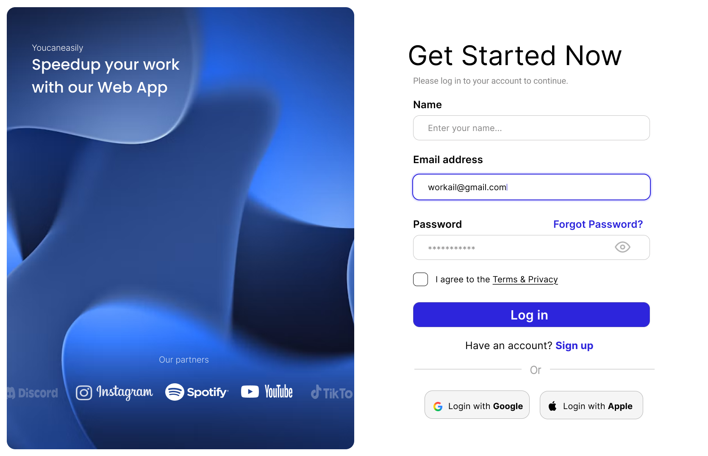
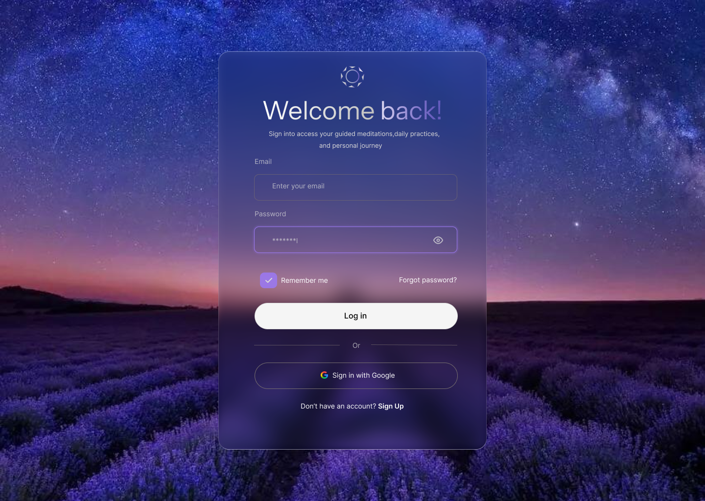
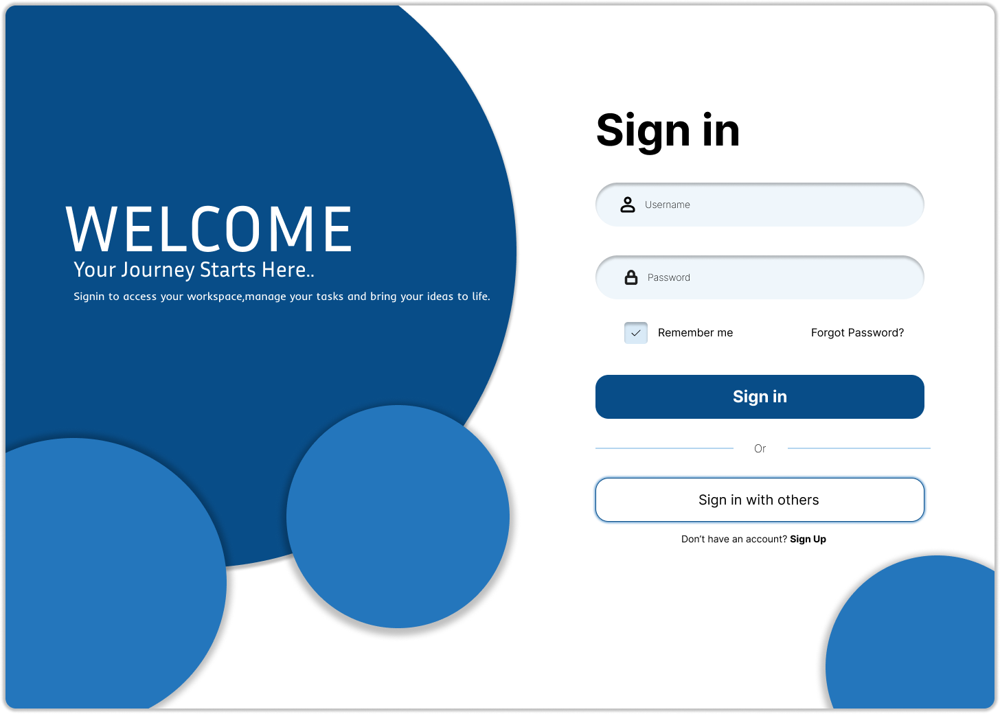
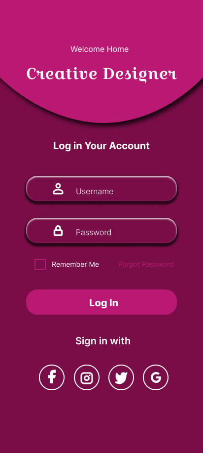
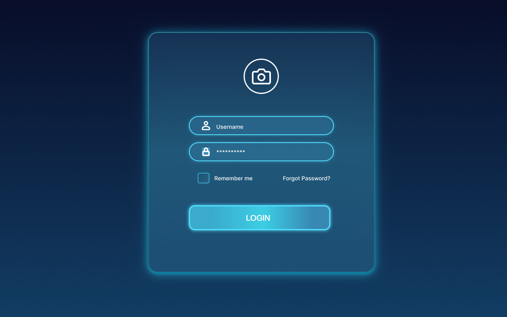

# Modern-Login-Form-UI
A modern login form UI design created as a UI/UX design practice project.

# Design Highlights

 Clean and modern interface

 Username and password input fields

 Glowing border and lighting effects

 Carefully selected color palette

 Focus on visual hierarchy and user experience

# Tools Used

***Figma***

# UI Screenshots

# Purpose

Created as part of my UI/UX design learning journey to improve my visual design and interface design skills.
